# PelletCAN

Karta Home Assistant (`custom:pelletcan-card`) – wierna replika panelu **Estyma / Tekla Igneo Touch** – oraz konfiguracja **ESPHome** (XIAO ESP32-C6 + MCP2515), która czyta i zapisuje parametry kotła po magistrali CAN (CANopen SDO, węzeł 4, 125 kbit/s).

Projekt stworzony przez Romana Gorza (pomysł, kierunek, testy na własnej instalacji) z pomocą Claude – asystenta AI firmy Anthropic, który pomagał przy pisaniu kodu i dokumentacji.

<a href="https://buycoffee.to/ergie" target="_blank" rel="noopener"></a>

> ⚠️ Projekt nieoficjalny – nie zastępuje produktów Estyma. Zobacz [Ważne zastrzeżenia](#ważne-zastrzeżenia).

> Zrzuty ekranu poniżej pochodzą z danych testowych (nie z działającego kotła).

| Ekran główny | Palnik | Menu |
|---|---|---|
| 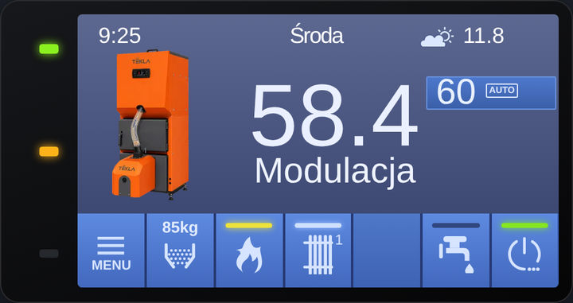 | 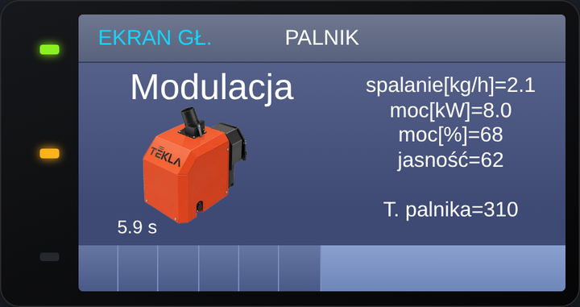 |  |

## Spis treści
1. [Co jest w środku](#co-jest-w-środku)
2. [Wymagania i połączenie](#wymagania-i-połączenie)
3. [Instalacja – krok po kroku](#instalacja--krok-po-kroku)
4. [Plik secrets.yaml – wymagane wpisy](#plik-secretsyaml--wymagane-wpisy)
5. [Awaryjny punkt dostępu Wi-Fi](#awaryjny-punkt-dostępu-wi-fi)
6. [Dodanie karty i konfiguracja](#dodanie-karty-i-konfiguracja)
7. [Tryb lite](#tryb-lite)
8. [Poziomy dostępu i PIN-y](#poziomy-dostępu-i-pin-y)
9. [Przegląd ekranów](#przegląd-ekranów)
10. [Grafiki](#grafiki)
11. [Rozwiązywanie problemów](#rozwiązywanie-problemów)
12. [Struktura repozytorium](#struktura-repozytorium)

## Co jest w środku
- **Firmware ESPHome** – plik użytkownika `esphome/PelletCAN.yaml` (ustawienia) + rdzeń `esphome/PelletCAN_packages.yaml` (logika, pobierany z GitHuba przy kompilacji) – odczyt temperatur, trybów, alarmów, harmonogramów i ustawień palnika, zapis nastaw, moc palnika w kW i spalanie liczone w ESP, poziomy dostępu z PIN-em, historia 20 alarmów z kotła.
- **Karta** (`dist/pelletcan-card.js`) – jeden plik wejściowy. Ma ekrany jak panel (główny, Ogrzewanie, Woda, Palnik, Menu z podmenu), edycję nastaw i harmonogramów, historię alarmów.
- **Katalog rejestrów CANopen** (`docs/rejestry/`) – opis i CSV znanych rejestrów węzła 4 i 86.

Karta nie wymaga szablonów (template sensors) ani helperów w HA. Elementy bez encji pokazują „-”.

## Wymagania i połączenie
- Home Assistant z integracją **ESPHome** (dodawanie urządzenia z kluczem API).
- Płytka **Seeed XIAO ESP32-C6** z **Seeed CAN Bus Breakout** (MCP2515, kwarc 16 MHz).
- Połączenie CAN z kotłem (CAN-H, CAN-L, masa); zworka P1 na płytce = terminator 120 Ω (domyślnie rozłączona).
- Piny SPI: SCK = GPIO19 (D8), MISO = GPIO20 (D9), MOSI = GPIO18 (D10), CS = GPIO17 (D7).
- Prędkość magistrali `125KBPS`, kwarc `16MHZ` (substitutions `can_bitrate`, `can_clock` – zmień, jeśli CAN pokazuje błąd).

## Instalacja – krok po kroku
1. **Przygotuj `secrets.yaml`** w katalogu ESPHome – [wymagane wpisy](#plik-secretsyaml--wymagane-wpisy).
2. **Sieć:** w `secrets.yaml` wpisz `wifi_ssid_iot` i `wifi_pass`. Wpisz `device_ip/device_gateway/device_subnet` (albo wyłącz stały adres i użyj DHCP) – patrz sekcja „Adres IP” niżej.
3. **Wgraj firmware**: skopiuj do ESPHome **tylko** plik `esphome/PelletCAN.yaml` (Twój plik: ustawienia `substitutions` + bloki `esphome`, `esp32`, `logger`, `web_server`, `captive_portal`, `api` i `packages`; cały kod, encje i usługi pobierze sam z GitHuba przez `packages`, niczego więcej nie edytujesz). **Aktualizując ze starszej wersji, wymień cały plik na nowy** (stare pliki użytkownika bez bloków `esp32`/`logger`/`api` z kluczem nie skompilują się z rdzeniem 1.2). Pierwszy raz wgraj po kablu USB. Kolejne aktualizacje: w ESPHome kliknij *Install* – pobierze najnowszy rdzeń z `main`.
4. **Dodaj urządzenie w HA** (Ustawienia → Urządzenia → ESPHome; klucz API z `secrets.yaml`). Pojawią się encje o nazwach z prefiksem `tekla` (np. `sensor.tekla_kociol_temperatura`).
5. **Zainstaluj kartę** – wybierz jedną z dwóch dróg:
   - **HACS (zalecane):** HACS → ⋮ → *Niestandardowe repozytoria* → adres `https://github.com/GieOeRZet/PelletCAN`, kategoria **Dashboard** (Lovelace) → *Dodaj* → znajdź „PelletCAN” → *Pobierz*. Zasób dashboardu doda się sam (`/hacsfiles/PelletCAN/pelletcan-card.js`). Aktualizacje pojawią się w HACS.
   - **Ręcznie:** skopiuj zawartość folderu `dist/` do `/config/www/community/pelletcan/` (powstanie `pelletcan-card.js`, `tekla-panel-card.js` i folder `img/`; pliki muszą leżeć razem). W Ustawienia → Dashboardy → ⋮ → Zasoby dodaj *moduł JavaScript* o adresie `/local/community/pelletcan/pelletcan-card.js?v=1`; po każdej aktualizacji zmień `?v=` i odśwież stronę (Ctrl+F5).
6. **Nie dodawaj obu naraz** – jeśli przechodzisz z instalacji ręcznej na HACS, usuń najpierw stary zasób `/local/community/pelletcan/...`.
7. **Dodaj kartę** na dashboard – [opis poniżej](#dodanie-karty-i-konfiguracja).


## Dwie wersje firmware: `main` i `test`
- **`main`** (domyślna) – podział na plik użytkownika (`PelletCAN.yaml`) i rdzeń (`PelletCAN_packages.yaml`) pobierany z GitHuba przy każdej kompilacji. Wymaga dostępu ESPHome do internetu przy buildzie.
- **`test`** – jeden kompletny plik `esphome/tekla-estyma.yaml` ze wszystkim w środku (bez pobierania z GitHuba). Użyj, gdy chcesz mieć wszystko lokalnie albo gdy podział nie działa: `git clone -b test https://github.com/GieOeRZet/PelletCAN.git`.

## Plik secrets.yaml – wymagane wpisy
Wzór: `esphome/secrets.example.yaml`. Plik `secrets.yaml` nie trafia do repozytorium (`.gitignore`).

| Klucz | Do czego | Uwagi |
|---|---|---|
| `wifi_ssid_iot` | nazwa sieci Wi-Fi | sieć 2,4 GHz |
| `wifi_pass` | hasło sieci Wi-Fi | |
| `esp_api_key_tekla_CAN` | klucz szyfrowania API (HA ↔ ESP) | 32 bajty w base64; wygeneruj w ESPHome (*Encryption key*) |
| `ota_pass` | hasło aktualizacji bezprzewodowej (OTA) | dowolne, silne |

**Hasło awaryjnej sieci (`ap_pass`) NIE jest w `secrets.yaml`** – jest jawne w sekcji `substitutions` pliku `PelletCAN.yaml` (domyślnie `11223344`) i możesz je tam zmienić. Dotyczy tylko awaryjnej sieci `Tekla-Estyma Fallback`.

PIN-y instalatora (0900 = klucz 1, 0999 = klucz 2) to domyślne PIN-y z oprogramowania panelu Tekla – są jawne w YAML (`pin_installer1`, `pin_installer2`) i nie wymagają wpisu w `secrets.yaml`.

## Adres IP: stały albo DHCP
Adresy wpisujesz w `substitutions` pliku `esphome/PelletCAN.yaml`:
```yaml
  device_ip: 192.168.10.250      # Twój adres (wpisz swoje wartości!)
  device_gateway: 192.168.10.1   # brama (router)
  device_subnet: 255.255.254.0   # maska sieci
```
Na dole pliku jest blok `wifi: manual_ip`, który tych wartości używa. **Chcesz DHCP?** Zakomentuj albo usuń cały blok `wifi:` – wtedy HA znajdzie urządzenie po nazwie `tekla-estyma`. Adresy to sieć lokalna, więc nie trafiają do `secrets.yaml`.

## Awaryjny punkt dostępu Wi-Fi
Jeśli ESP nie połączy się z siecią (zmiana routera, złe hasło, nowa sieć), po ok. minucie sam wystawia sieć **`Tekla-Estyma Fallback`** (hasło z `substitutions: ap_pass` w YAML, domyślnie `11223344`). Po połączeniu otwiera się strona logowania (portal captive; jeśli nie – wejdź na `192.168.4.1`), gdzie wybierasz sieć i wpisujesz hasło. Urządzenie zapisuje dane i łączy się z siecią. Ponieważ w firmware jest stały adres IP (`device_ip`), w nowej sieci musi on pasować do jej podsieci – w razie potrzeby wgraj firmware z poprawionym adresem. Po powrocie do sieci urządzenie pojawi się w ESPHome i w HA.

## Dodanie karty i konfiguracja
Dodaj kartę **Tekla panel** z listy kart (edytor wizualny) albo wklej YAML. Najprostsza konfiguracja:

```yaml
type: custom:pelletcan-card
```

Karta **sama znajduje encje** urządzenia po nazwie (domyślny prefiks `tekla`). Pozycje bez encji pokazują „-”, a brak encji nigdy nie powoduje błędu karty.

### Opcje YAML
| Opcja | Domyślnie | Opis |
|---|---|---|
| `screen` | `main` | ekran startowy (`main`, `heat`, `water`, `burn`, `menu`, `alarm`, `info` i inne – lista w edytorze) |
| `lite` | `false` | tryb lite – patrz [niżej](#tryb-lite); tylko w YAML, nie ma go w edytorze |
| `entity_prefix` | `tekla` | fragment nazwy urządzenia używany do wykrywania encji |
| `esphome_node` | `tekla_estyma` | nazwa węzła ESPHome (usługi `esphome.<węzeł>_...`) |
| `mirror` | z ESP | `true` blokuje zapisy w tej karcie (tylko podgląd) |
| `entities` | – | ręczne wskazanie encji dla wybranych pozycji (nadpisuje wykrywanie) |

```yaml
type: custom:pelletcan-card
screen: main
entity_prefix: tekla
entities:
  boiler_temp: sensor.moj_kociol_temperatura   # opcjonalnie – własna encja zamiast wykrytej
```

### Edytor wizualny
Edytor jest podzielony tak jak karta – według ekranów i menu:
1. **Ogólne** – ekran startowy, prefiks encji, węzeł ESPHome, tryb mirror (u góry widać, ile pozycji wykryto automatycznie i których brakuje).
2. **Ekran główny i ekran Kocioł**, **Ekran główny – Palnik i zbiornik**, **Ekran Ogrzewanie (CO)**, **Ekran Woda użytkowa (CWU)**.
3. **Menu →** Palnik → NASTAWY (użytkownik / klucz 1 / klucz 2), Ciepła woda → NASTAWY, Ogrzewanie obwód 1 → NASTAWY, Kocioł → NASTAWY, Historia alarmów, Statystyki i Test wyjść.
4. **System** – łączność CAN, tryb mirror, poziom dostępu.

W trybie lite sekcje klucza 1 i 2 są ukryte.

## Tryb lite
Jedna karta, dwa tryby. W YAML (wysoko w konfiguracji karty):

```yaml
type: custom:pelletcan-card
lite: true
```

- `lite: false` (domyślnie) – pełna karta z poziomami dostępu i PIN-em.
- `lite: true` – karta zawsze na **poziomie 0** (zwykły użytkownik). W menu nie ma pozycji **Poziom menu (PIN)**, klucz 1 i 2 są niedostępne, nie ma też ekranów serwisowych (Test wyjść, Statystyki, Sieć). Nawet jeśli w HA jest odblokowany wyższy poziom, karta lite go nie pokazuje.

Dawne typy `custom:tekla-panel-card` i `custom:tekla-panel-card_lite` działają nadal (to ta sama karta; `_lite` = `lite: true`). Nowe karty dodawaj jako `custom:pelletcan-card`.

| Pełna karta, poziom 0 | Pełna karta, klucz 1 | Lite |
|---|---|---|
|  | 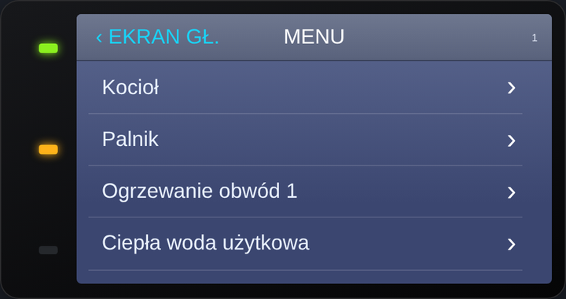 |  |

## Poziomy dostępu i PIN-y
- **Poziom 0** – użytkownik: Kocioł, Palnik, Ogrzewanie obwód 1, Ciepła woda, Historia alarmów, Informacje.
- **Klucz 1** (PIN 0900) – dodatkowo Język, Alarm dźwiękowy, Konfiguracja, Test wyjść (podgląd), Statystyki, Sieć oraz nastawy palnika klucza 1.
- **Klucz 2** (PIN 0999) – dodatkowo nastawy palnika klucza 2 (bezwładność, ruch rusztu, itd.) oraz **sterowanie w Teście wyjść**.

PIN wpisuje się w menu **Poziom menu (PIN)**. Poziom jest utrzymywany w ESP (sensor „Poziom dostępu”), wraca do 0 po 5 min bezczynności (`pin_autolock_min`) i po restarcie. Po wpisaniu któregokolwiek PIN-u ustawienia danego poziomu odświeżają się automatycznie. ESP odrzuca zapis parametru wymagającego wyższego poziomu.

Odczyt ustawień: po starcie ESP czyta wszystkie ustawienia (najpierw poziom 0), poziom 0 jest odświeżany cyklicznie, a klucz 1 i 2 – po PIN-ie, po zapisie i na żądanie (klik w nazwę dnia tygodnia na ekranie głównym).

## Przegląd ekranów
| Ogrzewanie | Woda | Kocioł |
|---|---|---|
| 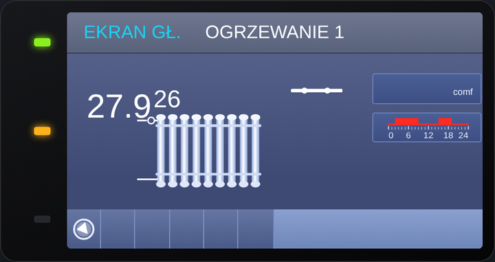 | 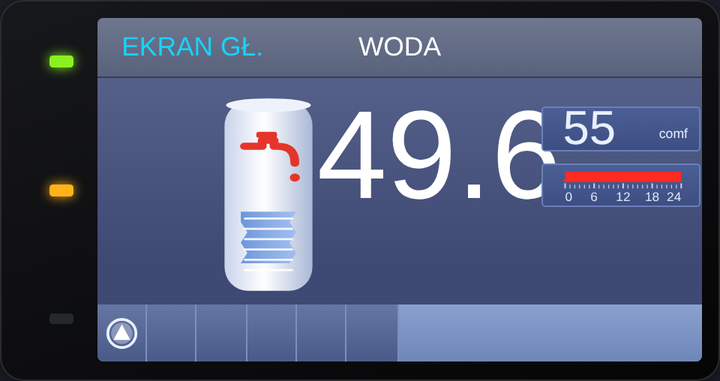 | 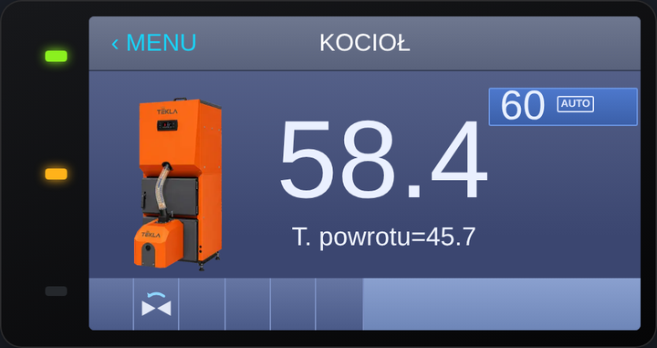 |

| Nastawy palnika | Nastawy ogrzewania | Nastawy wody |
|---|---|---|
|  | 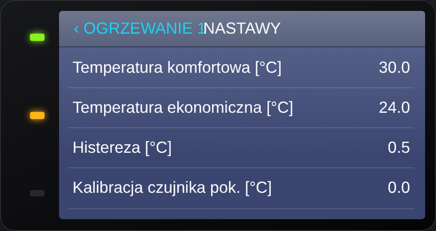 | 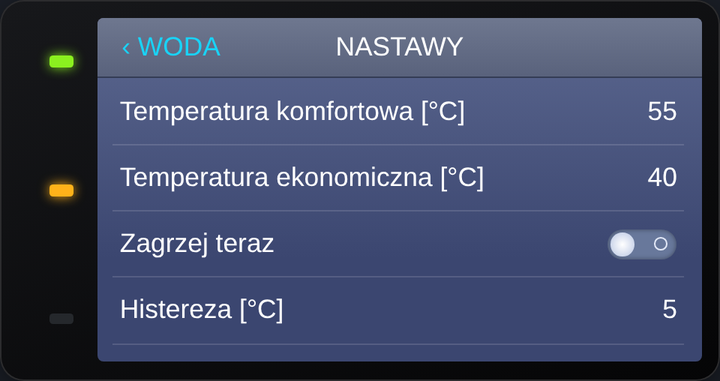 |

| Historia alarmów | Harmonogram | Informacje |
|---|---|---|
| 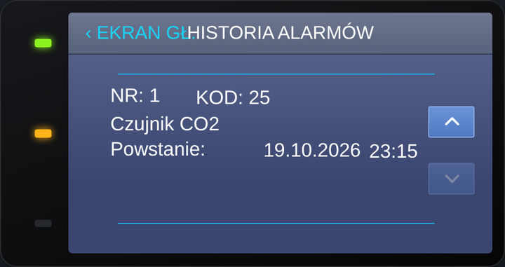 | 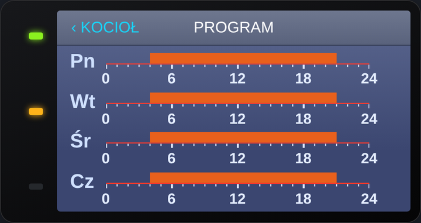 | 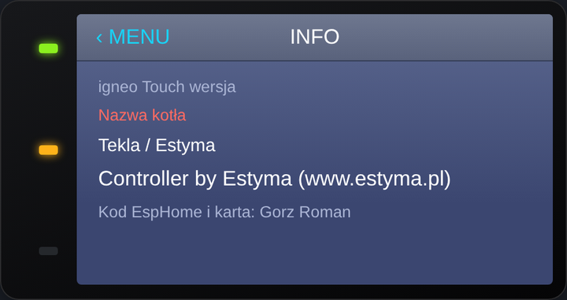 |

| Szybkie ustawienia | Paliwo | PIN |
|---|---|---|
| 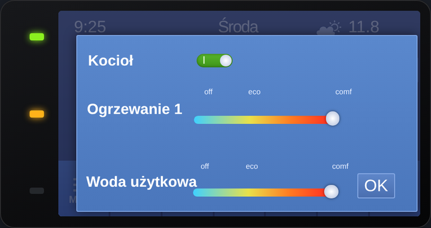 | 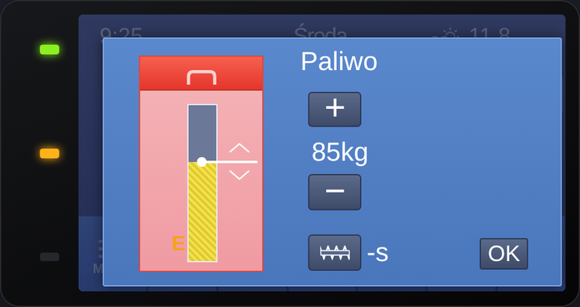 | 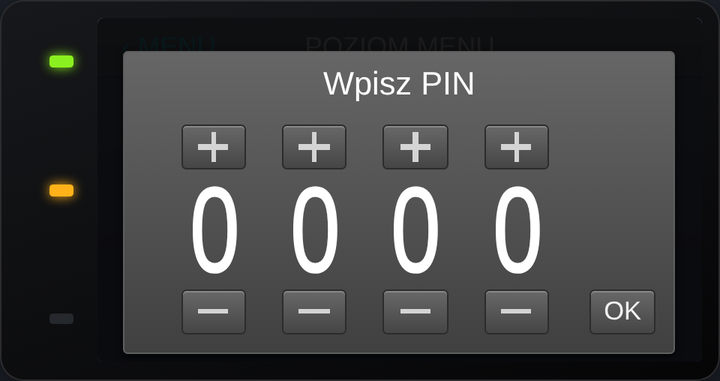 |

| Nastawy palnika, klucz 1 | Nastawy palnika, klucz 2 |
|---|---|
| 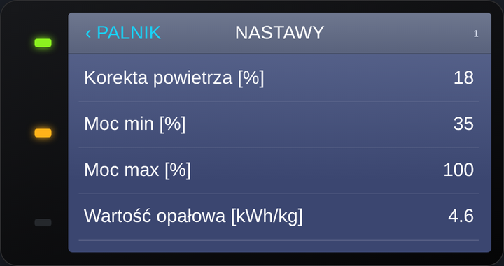 |  |

Historia alarmów jest czytana z bufora kotła (20 ostatnich wpisów, encje „Alarm wpis 1..20” – wymaga firmware ≥ 2.25).

## Grafiki
Karta używa `img/kociol.*`, `img/palnik.*`, `img/bojler.*` (png, webp, jpg, jpeg, svg – w tej kolejności). Wgraj własny plik do folderu `img/` obok karty (HACS: `/config/www/community/pelletcan/img/`, ręcznie: `/config/www/community/pelletcan/img/`), aby podmienić domyślny, i odśwież stronę (Ctrl+F5).

## Rozwiązywanie problemów
- **Wszędzie „-”** – karta nie widzi encji. Sprawdź, czy nazwy encji zawierają `tekla` (albo ustaw `entity_prefix`) i czy urządzenie jest dodane w HA.
- **Karta się nie zmienia po aktualizacji** – zmień `?v=` w adresie zasobu i odśwież stronę (Ctrl+F5); pliki z `/local/` są mocno buforowane.
- **Edycja nie działa** – sprawdź tryb mirror (encja „Tryb mirror”, opcja `mirror`) i poziom dostępu (część nastaw wymaga klucza 1 lub 2).
- **CAN pokazuje błąd** – sprawdź okablowanie, terminator, `can_bitrate` i `can_clock` w substitutions.
- **Brak sieci Wi-Fi po zmianie routera** – skorzystaj z [awaryjnego punktu dostępu](#awaryjny-punkt-dostępu-wi-fi).

## Struktura repozytorium
| Ścieżka | Co to |
|---|---|
| `esphome/PelletCAN.yaml` | firmware ESPHome (historia zmian w nagłówku) |
| `esphome/secrets.example.yaml` | wzór `secrets.yaml` |
| `dist/pelletcan-card.js` | karta – jedyny plik dodawany jako zasób dashboardu |
| `dist/tekla-panel-card.js` | rdzeń karty, pobierany przez `pelletcan-card.js` |
| `dist/img/` | grafiki kotła, palnika i bojlera (można podmienić) |
| `docs/rejestry/` | katalog rejestrów CANopen (opis + CSV) |
| `docs/img/` | zrzuty ekranu do tego README |
| `CHANGELOG.md`, `CHANGELOG-firmware.md` | historia zmian karty i firmware |

## Ostatnie zmiany
- **v1.0 (karta i firmware)** – pierwsze oficjalne wydanie PelletCAN. Wszystko, co powstało w wersjach roboczych, jest stanem v1.0 – szczegóły w [CHANGELOG.md](CHANGELOG.md) (karta) i [CHANGELOG-firmware.md](CHANGELOG-firmware.md) (firmware).

### Jak działa informacja o aktualizacji
Karta pobiera `version.json` z GitHuba (raz na 6 h) i porównuje z wersją firmware (encja „Wersja firmware”) oraz z własną wersją. Przy nowszej wersji pokazuje zieloną diodę; „Odrzuć aktualizację” ukrywa daną wersję (pamięć przeglądarki). Aktualizacja firmware: pobierz repo i kliknij „Install” w ESPHome; karty: podmień pliki w `dist/` i zrób Ctrl+F5. Przy wydaniu nowej wersji podbij numer i changelog w `version.json`.

## Ważne zastrzeżenia

- **Projekt niezależny i nieoficjalny.** PelletCAN nie jest produktem, nie jest współtworzony, zatwierdzony ani wspierany przez firmę Tekla (producenta kotłów) ani Estyma (producenta sterowników). Nie zastępuje oryginalnego produktu.
- **Zachęcamy do zakupu i instalacji wyłącznie oryginalnych modułów** dopuszczonych przez producenta kotła (Tekla) i producenta sterowników (Estyma).
- **Gwarancja.** Odczyt i zapis parametrów za pomocą jakiegokolwiek urządzenia innego niż produkt dopuszczony przez producenta kotła (Tekla) i producenta sterowników (Estyma) może naruszać warunki gwarancji oraz prowadzić do uszkodzenia lub nieprawidłowej pracy kotła i sterownika. Autor za to nie odpowiada.
- **Odpowiedzialność użytkownika.** Wszelkie zmiany sprzętowe (podłączenie do magistrali CAN, montaż modułów) oraz zapisy parametrów użytkownik wykonuje wyłącznie na własne ryzyko i własną odpowiedzialność. Oprogramowanie jest dostarczane „tak jak jest”, bez gwarancji.
- **Skąd wiedza o protokole.** Projekt powstał na podstawie obserwacji komunikacji CAN (standard CANopen) własnej, legalnie zakupionej instalacji, w celu zapewnienia współpracy (interoperacyjności) z Home Assistant. Kod jest napisany samodzielnie przez autora. Repozytorium nie zawiera kodu, firmware'u, plików ani dokumentacji producentów i nie obchodzi żadnych zabezpieczeń technicznych.
- **Znaki towarowe.** Nazwy Tekla, Estyma, Igneo i Igneo Touch oraz ich znaki towarowe należą do ich właścicieli i są użyte wyłącznie informacyjnie, dla opisania zgodności. Wygląd karty jest odwzorowaniem układu panelu na potrzeby własnej instalacji.
- Właściciel praw, który uważa, że jakaś treść narusza jego prawa, może zgłosić to przez [Issues](https://github.com/GieOeRZet/PelletCAN/issues) – sprawa zostanie rozpatrzona, a treść w razie potrzeby usunięta.

## Licencja
Kod jest otwarty: możesz go czytać, pobierać, modyfikować i udostępniać dalej z zachowaniem informacji o autorze (Roman Gorz, PelletCAN) i tej samej licencji – **ale wyłącznie niekomercyjnie**. Autor nie wyraża zgody na wykorzystanie tej pracy do zarobku (sprzedaż, usługi płatne, wbudowanie w produkt komercyjny) bez pisemnej zgody. Szczegóły w pliku [LICENSE](LICENSE). Uwaga: licencja z zakazem użycia komercyjnego nie spełnia formalnej definicji „open source” (OSI) – to kod z otwartymi źródłami (source-available).

## Wsparcie
Projekt jest darmowy. Jeśli chcesz, możesz go wesprzeć przez [buycoffee.to/ergie](https://buycoffee.to/ergie) – to sposób, by docenić mój poświęcony czas, włożoną pracę i własne środki (sprzęt, testy). Wsparcie jest dobrowolne i niczego nie daje w zamian, nie jest płatnością za produkt ani usługę.

<a href="https://buycoffee.to/ergie" target="_blank" rel="noopener"></a>


